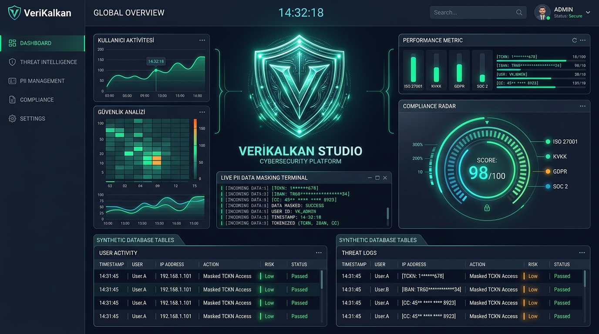
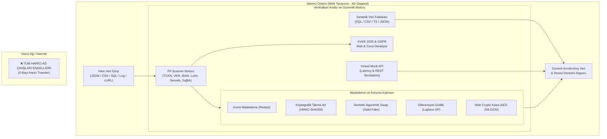

<div align="center">

# 🛡️ VeriKalkan Studio
### Sıfır-Bilgi KVKK & GDPR Veri Maskeleme, PII Keşif ve Sentetik Test Verisi Platformu
**Zero-Trust Client-Side PII Detection, Data Sanitization, Pseudonymization & Synthetic Data Foundry**

[](https://github.com/goktugis/verikalkan)
[](https://github.com/goktugis/verikalkan)
[](https://github.com/goktugis/verikalkan)
[](https://github.com/goktugis/verikalkan)
[](LICENSE)

<br/>



</div>

---

## 📌 Proje Hakkında (Executive Summary)

Modern yazılım geliştirme döngülerinde ekiplerin en büyük çıkmazlarından biri: **"Gerçekçi test verisine ihtiyaç duymak fakat üretim (production) verilerini staging ortamına veya yapay zeka promptlarına aktarmanın kanunen yasak olmasıdır."**

Türkiye **6698 Sayılı Kişisel Verilerin Korunması Kanunu (KVKK)**, Avrupa **GDPR** ve **PCI-DSS v4.0** mevzuatları; TCKN, kredi kartı, IBAN, sağlık ve iletişim verilerinin açık şekilde test ortamlarında, log dosyalarında ya da üçüncü taraf LLM servislerinde bulunmasını ağır cezai yaptırımlara bağlamıştır.

**VeriKalkan Studio**, bu problemi çözmek için geliştirilmiş **%100 istemci taraflı (Client-Side Zero-Trust)** çalışan yeni nesil bir veri güvenliği ve sentetik veri kokpitidir. Verileriniz hiçbir harici sunucuya veya üçüncü tarafa iletilmez; tüm regex, NER heuristiği, kriptografik dönüşüm ve diferansiyel gizlilik algoritmaları doğrudan tarayıcınızın Web Worker ortamında çalışır.

---

## ✨ Temel Özellikler

### 1. 🔍 Canlı Hassas Veri Tarayıcısı (PII & KVKK Scanner)
- **15+ Türk ve Küresel Algoritmik Denetim:**
  - **TCKN (T.C. Kimlik No):** 11 basamaklı tek/çift hane çapraz çarpım ve Mod-10 kontrolü.
  - **VKN (Vergi Kimlik No):** Gelir İdaresi 10 haneli modüler ağırlık algoritması.
  - **TR IBAN:** ISO 7064 Mod 97-10 uluslararası banka hesap doğrulayıcısı.
  - **Ödeme Kartları (Luhn MOD-10):** Troy, Visa, Mastercard ve Amex için anlık BIN/IIN tespiti.
  - **GSM Telefonları:** Türkiye +90 5xx ve 05xx numara kalıpları.
  - **E-Posta Adresleri:** RFC 5322 uyumlu e-posta keşfi.
  - **Özel Nitelikli Sağlık Verileri (KVKK Md. 6):** Kan grubu, ICD tanıları, engellilik/reçete terimleri.
  - **Geliştirici Sızıntı Avcısı (Secrets):** OpenAI API Keys (`sk-...`), GitHub PAT (`ghp_...`), AWS Access Keys (`AKIA...`), Bearer Tokenlar, JSON Web Token (JWT) ayrıştırıcı ve Private Key blokları.

### 2. 🛡️ 5 Farklı Maskeleme ve Dönüştürme Stratejisi
1. **Kısmi Maskeleme (Redaction):** `123*****89`, `TR33 **** **** 9012` — Ekran görüntüleri, hata bildirimleri ve kullanıcı arayüzleri için.
2. **Kriptografik Takma Adlama (Pseudonymization):** Salted HMAC-SHA256 ile ilişkisel veri tabanındaki JOIN bütünlüğünü bozmayan deterministik kimlikler (`ANON_TCKN_8f3a92bc`).
3. **Algoritmik Sentetik Değiştirme (Synthetic Swap):** Gerçek TCKN yerine **algoritmayı doğrulayan geçerli sahte TCKN**, gerçek IBAN yerine **ISO 7064 geçerli sahte TR IBAN** ve gerçek kart yerine **Luhn geçerli Troy/Visa kartı** üretir. Yazılım testleriniz asla kırılmaz!
4. **Diferansiyel Gizlilik (Differential Privacy / Perturbation):** Maaş, işlem tutarı ve yaş gibi sayısal sütunlara Laplace gürültüsü ekler; genel istatistiksel ortalama korunurken tekil kimlikler gizlenir.
5. **Kriptografik Kasa (AES-256-GCM Vault):** Web Crypto API ile tarayıcıda kullanıcı parolasıyla şifreler, istendiğinde geri çözülebilir.

### 3. 📊 KVKK & GDPR Yasal Risk ve Ceza Radarı
- **0–100 Güvenlik Skoru** ve dinamik harf notu (A+, A, B, C, D, F).
- **KVKK 2026 Tahmini İdari Para Cezası Risk Göstergesi:** 6698 Sayılı Kanun Madde 18 yeniden değerleme oranlarına dayalı potansiyel yaptırım marjı (₺).
- **Uluslararası Uyumluluk Matrisi:**
  - `KVKK Md. 12` — Veri Güvenliğine İlişkin Teknik Tedbirler
  - `KVKK Md. 6` — Özel Nitelikli Kişisel Veri Güvenliği
  - `GDPR Art. 32` — Security of Processing & Pseudonymisation
  - `PCI-DSS v4.0 Req 3.3` — Primary Account Number (PAN) Maskeleme
  - `ISO/IEC 27701` — Gizlilik Bilgi Yönetimi Sistemi (PIMS)
- **Tek Tıkla Resmi Denetim Raporu:** PDF / Yazdırma formatında onaylı denetim sertifikası.

### 4. 🏭 Sentetik İlişkisel Veri Fabrikası (Foundry)
- İlişkisel hazır veri şablonları:
  - 👤 **Kullanıcı & Müşteri Veritabanı**
  - 💳 **Finansal FAST / EFT Hareketleri**
  - 📦 **E-Ticaret Sipariş & Fatura Kayıtları**
  - 🏥 **Sağlık & Poliklinik Randevu Protokolleri**
  - 🖥️ **Mikroservis Sistem & API Erişim Logları**
- **Çoklu Dışa Aktarım Formatları:**
  - `JSON` formatı
  - `CSV` (Excel / Google Sheets uyumlu)
  - `SQL` (`CREATE TABLE` ve `INSERT INTO` dökümleri)
  - `TypeScript` (`interface` ve mock dizi tanımları)

### 5. ⚡ Tarayıcı İçi Canlı Mock API Sunucusu
- İstemci içinde çalışan sanal REST endpointleri:
  - `POST /api/v1/sanitize`
  - `POST /api/v1/validate`
  - `GET /api/v1/synthetic/users`
  - `POST /api/v1/compliance/audit`
- Ağ gecikmesi simülasyonu (Latency Slider 20ms - 500ms).
- Otomatik terminal `cURL` komut oluşturucusu.

### 6. 🧪 Matematiksel Algoritma Laboratuvarı
- TCKN, VKN, IBAN ve Luhn algoritmalarının matematik adımlarını (tek/çift toplamlar, matris katsayıları, ISO mod hesaplamaları) görselleştiren canlı interaktif laboratuvar.

---

## 🏛️ Mimari & Sıfır-Güven (Zero-Trust) Modeli



---

## 📐 Matematiksel Algoritma Referansları

### 1. TCKN Doğrulama ve Üretim Algoritması
11 haneli TCKN dizisi $d_0, d_1, \dots, d_{10}$ için:
- $d_0 \neq 0$
- $d_9 = \left( 7 \times (d_0 + d_2 + d_4 + d_6 + d_8) - (d_1 + d_3 + d_5 + d_7) \right) \pmod{10}$
- $d_{10} = \left( \sum_{i=0}^{9} d_i \right) \pmod{10}$

### 2. TR IBAN (ISO 7064 Mod 97-10)
Türkiye IBAN dizisi (TR + 2 kontrol hanesi + 22 BBAN hanesi):
- İlk 4 karakter sona taşınır: $\text{BBAN} + \text{TR} + \text{Kontrol}$
- Harfler sayılara dönüştürülür: $T=29, R=27$
- Oluşan 28 basamaklı tamsayı için:
  $$\text{NumericString} \pmod{97} \equiv 1$$

### 3. Diferansiyel Gizlilik (Laplace Gürültüsü)
Bir $f(x)$ sayısal sorgusu ve $\epsilon$ gizlilik bütçesi için:
$$X = \mu - b \cdot \text{sgn}(U) \cdot \ln(1 - 2|U|), \quad b = \frac{\Delta f}{\epsilon}, \quad U \in (-0.5, 0.5)$$

---

## 🚀 Kurulum ve Yerel Çalıştırma

### Gereksinimler
- Node.js 18+ (Node v24 önerilir)
- npm veya pnpm

### Adımlar

```bash
# 1. Depoyu klonlayın
git clone https://github.com/goktugis/verikalkan.git
cd verikalkan

# 2. Bağımlılıkları yükleyin
npm install

# 3. Testleri çalıştırın
npm test

# 4. Geliştirici sunucusunu başlatın
npm run dev
```

Tarayıcınızda `http://localhost:5173` adresine giderek VeriKalkan Studio'yu kullanmaya başlayabilirsiniz.

### Üretim Derlemesi (Build)

```bash
npm run build
npm run preview
```

---

## 🧪 Test Kapsamı (Vitest)

Proje, algoritmik doğruluğu ve güvenlik kabiliyetlerini güvence altına alan kapsamlı bir test paketine sahiptir:

```bash
✓ src/__tests__/tckn.test.ts (3 tests)
✓ src/__tests__/vkn.test.ts (3 tests)
✓ src/__tests__/iban.test.ts (4 tests)
✓ src/__tests__/luhn.test.ts (3 tests)
✓ src/__tests__/differential.test.ts (3 tests)
✓ src/__tests__/scanner.test.ts (2 tests)
✓ src/__tests__/sanitizer.test.ts (3 tests)
✓ src/__tests__/compliance.test.ts (2 tests)

Test Files  8 passed (8)
Tests       23 passed (23)
```

---

## 🔒 Güvenlik Politikası & Gizlilik Taahhüdü

- **Sıfır Telemetri:** Uygulama hiçbir analitik, takip kodu veya harici API çağrısı içermez.
- **Air-Gapped Çalışma:** Tarayıcınızın internet bağlantısını kesseniz dahi uygulama %100 işlevseldir.
- **Sıfır Gizli Anahtar:** Kaynak kodda hiçbir gizli parola, API key veya token yer almaz.
- **Kriptografik Standart:** İstemci tarafı şifreleme işlemlerinde W3C Web Cryptography API standartlarındaki AES-GCM-256 ve PBKDF2 (100.000 iterasyon) kullanılır.

---

## 📄 Lisans

Bu proje [MIT Lisansı](LICENSE) altında açık kaynak olarak sunulmuştur.

---

<div align="center">
  Geliştirici: <strong>Göktuğ İşeri</strong><br/>
  <em>Modern Yazılım Mühendisliği & Siber Güvenlik Mimarisi Referans Portföy Projesi</em>
</div>
